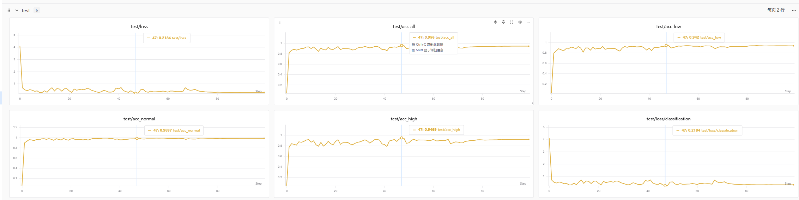

# EventTSign

Code for **Extreme Illumination-Robust Traffic Sign Classification with Event Cameras**.

## Results

Test loss and accuracy curves, including overall accuracy and accuracy under low, normal, and high illumination.



## Setup

Python 3.10+. Run commands from the repository root.

```bash
python -m pip install -r requirements.txt
```

## Dataset

Download the dataset and weights from [Baidu Netdisk](https://pan.baidu.com/s/1pTmmsKS1mf-oLTqNsUtB3Q?pwd=hmvp). Extraction code: `hmvp`.

Extract the dataset into:

```text
datasets/eventtsign/
  train_labels.csv
  test_labels.csv
  train/event/
  train/rgb/
  test/event/
  test/rgb/
```

## Train

Place the ConvNeXt V2 Nano initialization weights at `weights/convnextv2_nano_22k_224_ema.pt`, or update `model.pretrained_path` in `configs/hyper_tsign.yaml`.

```bash
python train.py --data-root datasets/eventtsign
```

Checkpoints are saved to `outputs/hyper_tsign/`.

## Evaluate

```bash
python evaluate.py --checkpoint outputs/hyper_tsign/best.pt --data-root datasets/eventtsign
```

To evaluate downloaded model weights, replace `--checkpoint` with the relative path to the downloaded file.

## Citation

If you use this project, please cite the manuscript ([BibTeX](CITATION.bib)):

```bibtex
@unpublished{zhang_extreme_illumination_event_cameras,
  title  = {Extreme Illumination-Robust Traffic Sign Classification with Event Cameras},
  author = {Zhang, Yongji and Li, Siqi and Chen, Wenbai and Xi, Haoning and Bao, Wei and Gao, Yue},
  note   = {Under review}
}
```
